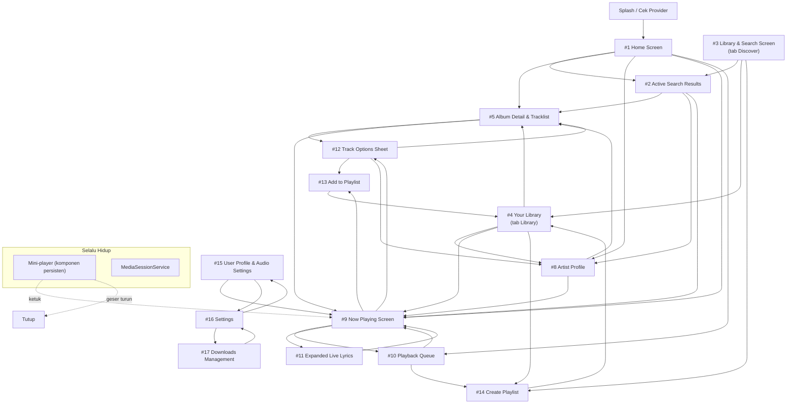
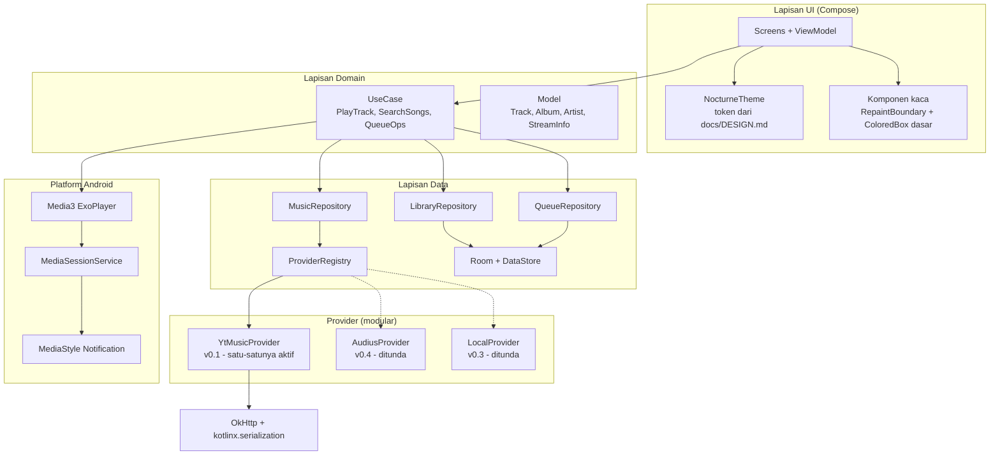

# 00 — Peta Navigasi & Arsitektur Lapisan

Bagian dari PRD Refy v0.2. Lihat `docs/PRD.md` dan `docs/DESIGN.md`.

**Perubahan penting dari v0.1:** navigasi mengikuti desain Stitch *Electric Purple Music App*, bukan rencana awal.

| | Draft awal (salah) | Desain (dipakai) |
|---|---|---|
| Tab 1 | Beranda | **Home** |
| Tab 2 | Cari | **Discover** (jelajah + cari jadi satu layar) |
| Tab 3 | Pustaka | **Library** |
| Tab 4 | Pengaturan | **Create** (buat playlist) |
| Pengaturan | tab sendiri | di dalam **User Profile & Audio Settings**, lewat avatar di header |
| Layar pencarian | tab terpisah | di dalam tab Discover, dengan hasil sebagai layar terpisah |

---

## Peta layar



## Layar mana masuk MVP

Desain punya **18 layar UI + 2 aset gambar** (17 layar nyata + 1 artefak); MVP tidak perlu semuanya. Bottom nav berbentuk **pil mengambang** (keputusan D11). Rincian keputusan **D7** (PRD §12):

| Layar | MVP? |
|---|---|
| #1 Home, #2 Active Search, #3 Discover (`library-search-screen`), #4 Library (`your-library`) | ya |
| #5 Album Detail, #8 Artist Profile | ya |
| #9 Now Playing, #10 Playback Queue | ya |
| #12 Track Options Sheet, #14 Create Playlist | ya |
| **#16 Settings** | **ya** — tanpa ini aplikasi tidak punya tempat ubah kualitas stream, tema, cache |
| #6 Album Detail (varian kedua "After Hours Deluxe") | ditunda — duplikat fungsional #5 |
| #7 Playlist Detail | ditunda |
| #11 Expanded Live Lyrics | ditunda (v0.2 — bersama lirik tersinkron) |
| #13 Add to Playlist | ditunda (v0.2 — setelah playlist stabil) |
| #17 Downloads Management | **tidak dipakai di v0.1** — fitur unduhan belum ada |

Catatan: #5 dan #6 sama-sama menggambarkan album "After Hours" — satu fitur digambar dua kali. Pilih satu saat implementasi.

---

## Aturan navigasi

| Aturan | Nilai |
|---|---|
| Struktur | Bottom navigation 4 tab: Home, Discover, Library, Create |
| Tinggi nav / header | **68px (pil mengambang, D11)** / 64px |
| Mini-player | Melayang 56px, **88–92px di atas dasar** (di atas pil nav), tampil saat antrean ada |
| Jarak aman konten | 160px dari dasar, supaya baris terakhir tidak tertutup |
| Now Playing | Layar penuh, dibuka dari mini-player / baris lagu; tutup dengan geser ke bawah |
| Pengaturan | Bukan tab; masuk lewat avatar di header Home |
| Antrean & Track Options | Sheet, tidak menghentikan pemutaran |
| Back | Tutup sheet → kembali ke tab → keluar (hanya bila tidak sedang memutar) |
| Deep link | Tidak ada di v1 |

## Arsitektur lapisan



## Kontrak ProviderRegistry (kunci agar app tidak mudah mati)

```kotlin
interface MusicProvider {
    val id: String                       // "ytmusic", "audius", "local"
    suspend fun search(query: String, type: SearchType): List<SearchResult>
    suspend fun getStreamInfo(trackId: String): StreamInfo   // URL audio + metadata
    suspend fun getRelated(trackId: String): List<Track>     // untuk autoplay
    val isEnabled: Boolean
}
```

Aturan:
1. Semua panggilan jaringan ke sumber musik **wajib** lewat `MusicProvider`. Tidak ada `OkHttp` langsung di ViewModel atau Composable.
2. `StreamInfo` memuat `expiresAt`; URL kedaluwarsa di-refresh otomatis sebelum dipakai.
3. Kalau `getStreamInfo` gagal dengan `ProviderBrokenException`, antrean **tidak dihentikan** — lagu dilewati, pengguna diberi tahu sekali per sesi.

## Catatan render (dari `docs/DESIGN.md` §9)

Header, bottom nav pil, dan mini-player memakai blur (24 / **30** / **36** px) dan **persisten di hampir semua layar**. Sejak nav jadi pil, nav dan mini-player hanya terpisah <20px — dua permukaan kaca rona terang berdampingan. Wajib:

1. `RepaintBoundary` di luar, lalu `ClipRRect`, lalu `ColoredBox` dasar **sebelum** efek blur.
2. Jangan biarkan dua permukaan kaca beririsan.
3. Sediakan jalur mundur tanpa blur (warna solid + garis 1px) yang benar-benar diuji.
4. Uji di perangkat GPU Mali nyata — emulator tidak mereproduksi artefaknya.
