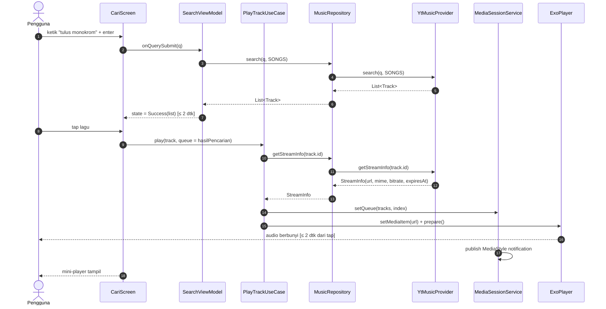
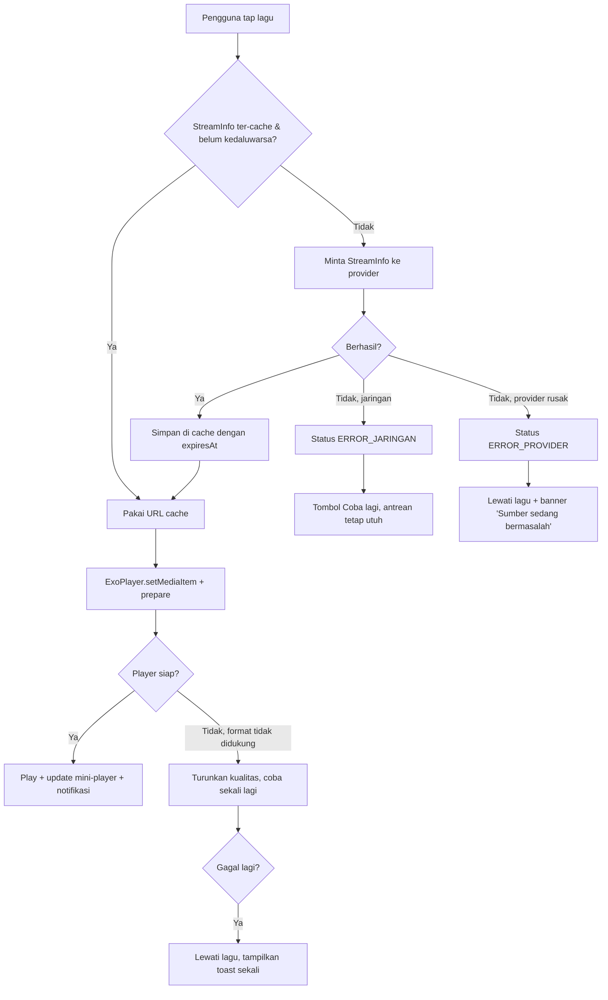
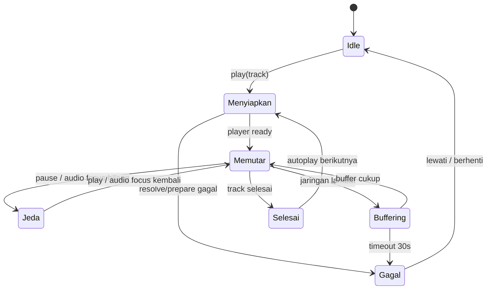

# 01 — Alur Putar Lagu

Bagian dari PRD Refy v0.2. Layar & ukuran mengikuti `docs/DESIGN.md` dan desain Stitch *Electric Purple Music App*.

| Elemen | Nilai dari desain |
|---|---|
| Layar pencarian | **#2** Active Search Results (masuk dari tab Discover **#3**) |
| Mini-player | 56px, melayang **88–92px** di atas dasar (di atas pil nav, D11), progress bar 2px di tepi bawah |
| Header hasil | `Top Result` + chip `Top / Songs / Albums / Artists / Playlists` |
| Baris hasil | 56px, artwork 44px, judul putih satu baris, artis muted satu baris |
| Keadaan sedang diputar | judul ungu `#8B5CF6` + glyph equalizer 3 batang |

## Alur utama: cari → putar

## Diagram keputusan saat memutar

## Status pemutar (state machine)

## Aturan

1. **Audio focus wajib dihormati.** Dapatkan fokus sebelum play; pause saat fokus hilang permanen (telepon masuk, app lain ambil alih); resume saat fokus kembali jika `AUDIOFOCUS_LOSS_TRANSIENT`.
2. **Menjadi noisy receiver.** Cabut headphone → pause, jangan auto-play.
3. **Kegagalan tidak boleh menutup aplikasi.** Semua jalur gagal berakhir di state dengan aksi yang bisa dilakukan pengguna.
4. **URL stream tidak boleh di-log.** Bisa dipakai orang lain; anggap sebagai rahasia sesi.
5. **Autoplay** memakai `getRelated(trackId)` provider; mati secara default di v0.1 sampai perilakunya stabil.
