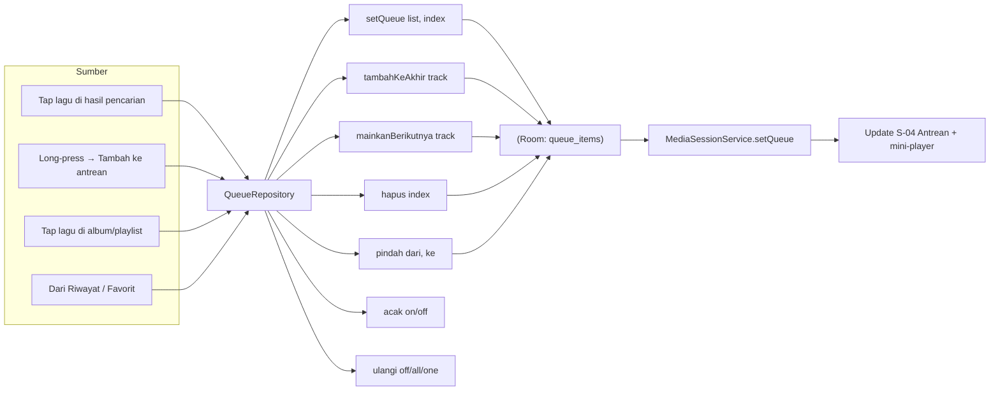
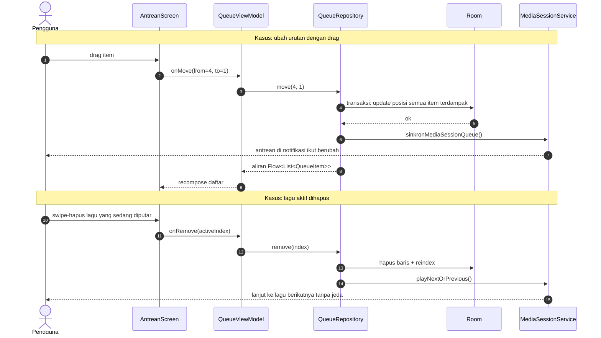

# 02 — Alur Antrean

Bagian dari PRD Refy v0.2. Layar acuan: **#10 Playback Queue** (bukan #9 — #9 adalah Now Playing Screen).

Catatan dari desain: baris antrean memakai **checkbox multi-pilih** (`check`) di kiri — bukan indeks angka seperti rencana awal. Tiap baris punya `drag_handle` di kanan. Header memuat `Clear all`, jumlah lagu + sisa waktu, tombol `Save as Playlist`, dan status `Autoplay Similar: ON`.

## Aksi antrean



## Urutan aksi pada layar Antrean



## Aturan

| Aturan | Detail |
|---|---|
| Persistensi | Seluruh antrean ditulis ke Room pada setiap mutasi; pulih setelah app dibunuh |
| Reindexing | Posisi disimpan sebagai kolom `position` integer; selalu di-renumber dalam satu transaksi untuk hindari duplikat |
| Batas ukuran | Antrean maksimum 5.000 item; melebihi itu, item terlama di bagian bawah dibuang |
| Lagu aktif dihapus | Otomatis lanjut ke item berikutnya (atau sebelumnya jika item terakhir) |
| Shuffle | Menyimpan **urutan asli** terpisah agar bisa dimatikan kembali tanpa kehilangan urutan |
| Repeat one | Mengulang tanpa menaikkan `position` |
| Putar ulang riwayat | Menambahkan seluruh daftar riwayat yang terlihat sebagai antrean baru |
| Sinkron ke MediaSession | Setiap mutasi memanggil `setQueue` supaya notifikasi & lockscreen tidak menyimpang dari UI |

## Tabel Room (v0.1)

```sql
CREATE TABLE queue_items (
  id           TEXT PRIMARY KEY,      -- trackId
  position     INTEGER NOT NULL,
  title        TEXT NOT NULL,
  artist       TEXT NOT NULL,
  album        TEXT,
  duration_ms  INTEGER NOT NULL,
  artwork_url  TEXT,
  source       TEXT NOT NULL          -- "ytmusic"
);
CREATE UNIQUE INDEX idx_queue_position ON queue_items(position);

CREATE TABLE favorites (
  track_id     TEXT PRIMARY KEY,
  added_at     INTEGER NOT NULL,
  title        TEXT NOT NULL,
  artist       TEXT NOT NULL,
  artwork_url  TEXT
);

CREATE TABLE history (
  track_id     TEXT NOT NULL,
  played_at    INTEGER NOT NULL,
  duration_ms  INTEGER NOT NULL,
  completed    INTEGER NOT NULL DEFAULT 0,
  PRIMARY KEY (track_id, played_at)
);

CREATE TABLE provider_cache (
  key          TEXT PRIMARY KEY,      -- "stream:<trackId>"
  payload      TEXT NOT NULL,
  expires_at   INTEGER NOT NULL
);

-- Playlist lokal (F-15 MUST). Tanpa dua tabel ini, "buat + kelola playlist"
-- tidak punya tempat menyimpan. Ditambahkan 2026-11-12.
CREATE TABLE playlists (
  id           TEXT PRIMARY KEY,      -- UUID v4, dibuat klien
  name         TEXT NOT NULL,
  description  TEXT,
  artwork_url  TEXT,
  created_at   INTEGER NOT NULL,
  updated_at   INTEGER NOT NULL
);

CREATE TABLE playlist_items (
  playlist_id  TEXT NOT NULL,
  track_id     TEXT NOT NULL,
  position     INTEGER NOT NULL,      -- di-renumber dalam satu transaksi, seperti queue_items
  title        TEXT NOT NULL,
  artist       TEXT NOT NULL,
  album        TEXT,
  duration_ms  INTEGER NOT NULL,
  artwork_url  TEXT,
  source       TEXT NOT NULL,         -- "ytmusic"
  added_at     INTEGER NOT NULL,
  PRIMARY KEY (playlist_id, track_id),
  FOREIGN KEY (playlist_id) REFERENCES playlists(id) ON DELETE CASCADE
);
CREATE UNIQUE INDEX idx_playlist_position ON playlist_items(playlist_id, position);
```

**Catatan skema:**

| Aturan | Detail |
|---|---|
| `playlists.id` | UUID dari klien, **bukan** autoincrement — playlist lokal tidak pernah sinkron ke server, jadi id harus stabil di seluruh perangkat tanpa koordinasi |
| Lagu yang sama dua kali | `PRIMARY KEY (playlist_id, track_id)` menolak duplikat. Kalau pengguna memang mau duplikat (mis. lagu muncul di dua posisi), ganti PK ke `(playlist_id, position)` — **belum diputuskan**, catat di `keputusan.md` kalau diubah |
| `ON DELETE CASCADE` | Hapus playlist ikut menghapus isinya; hapus lagu **tidak** menghapus baris playlist (metadata lagu disimpan di baris itu, bukan di tabel terpisah) |
| Kenapa metadata disalin | Sama seperti `queue_items`: pustaka harus tetap bisa dibuka saat resolver mati. Judul/artis/artwork ada di baris, tidak bergantung `provider_cache` |
| Dampak v0.2 (offline) | Tabel `downloads` menyusul di `flows/05`; `playlist_items.track_id` jadi kuncinya |
