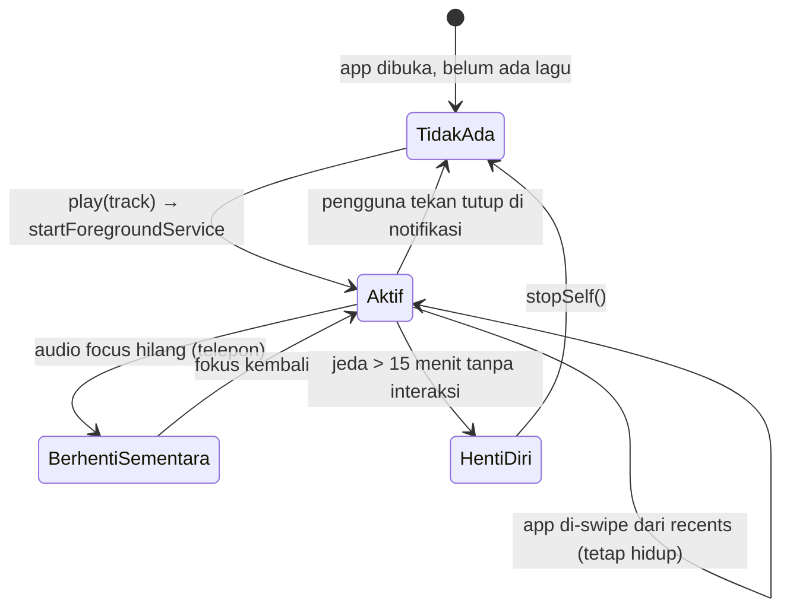
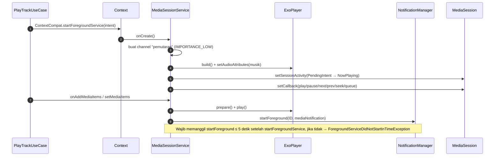
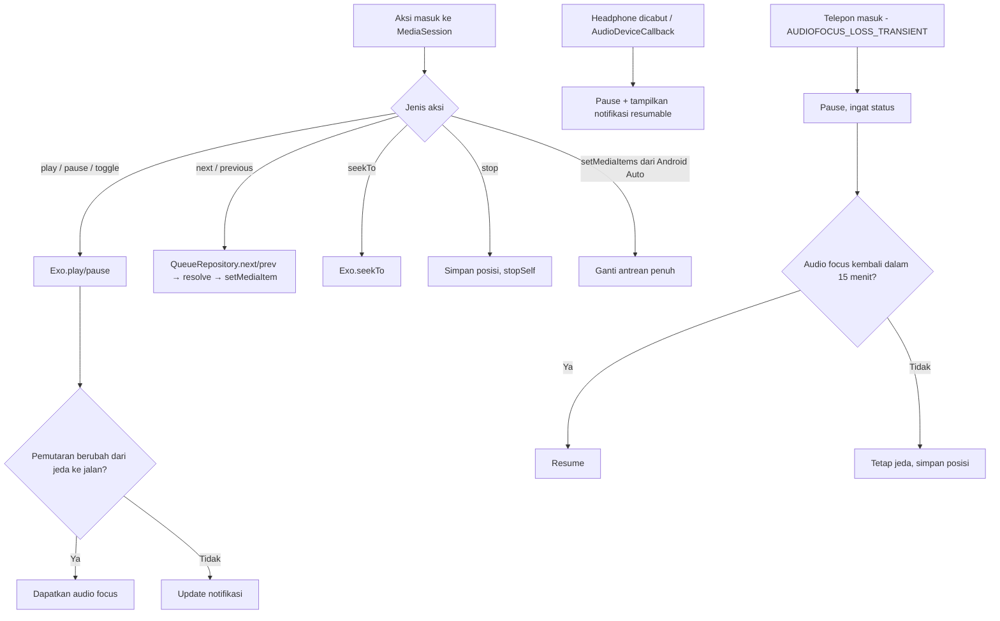

# 03 — Alur Background Service

Bagian dari PRD Refy v0.1. Inti kualitas aplikasi ada di berkas ini.

## Siklus hidup

## Urutan startup service

## Penanganan niat dari luar

## Persyaratan Android modern (wajib, sering bikin app gagal terbit)

| Syarat | Implementasi |
|---|---|
| `FOREGROUND_SERVICE` + `FOREGROUND_SERVICE_MEDIA_PLAYBACK` di manifest | Wajib untuk API 34+ |
| `POST_NOTIFICATIONS` runtime permission (API 33+) | Minta saat pertama tekan play, bukan saat app dibuka |
| Channel notifikasi `IMPORTANCE_LOW` | Agar tidak berbunyi & tidak muncul heads-up |
| `android:foregroundServiceType="mediaPlayback"` | Tanpa ini, service ditolak di API 34+ |
| `setSessionActivity` | Tanpa ini, tap notifikasi tidak membuka app |
| Batere: jangan minta `REQUEST_IGNORE_BATTERY_OPTIMIZATIONS` | Kebijakan Play menolak; di luar Play tetap berisiko. Dokumentasikan sebagai batasan |
| Media3 `MediaSessionService` | Jangan pakai `Service` mentah; sesi otomatis menangani Bluetooth & Android Auto |

## Kasus tepi & perilaku yang diharapkan

| Kasus | Perilaku yang benar |
|---|---|
| App di-swipe dari recents | Audio **tetap** jalan (perilaku yang diminta pengguna) |
| Pengguna tekan "tutup" di notifikasi | Audio berhenti, posisi disimpan, service `stopSelf` |
| Jeda > 15 menit | Service berhenti sendiri; antrean tetap tersimpan di Room |
| Bluetooth terputus | Pause; notifikasi tetap resumable |
| Jaringan hilang saat buffering | Status `Buffering` maksimum 30 detik, lalu `Gagal` + aksi coba lagi |
| Dua instance app dibuka | Tetap satu `MediaSessionService`; tidak ada dua audio bersamaan |
| Layar mati 60 menit | Putar terus; konsumsi baterai dipantau (KPI §2.2 PRD) |
