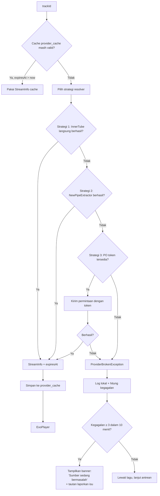
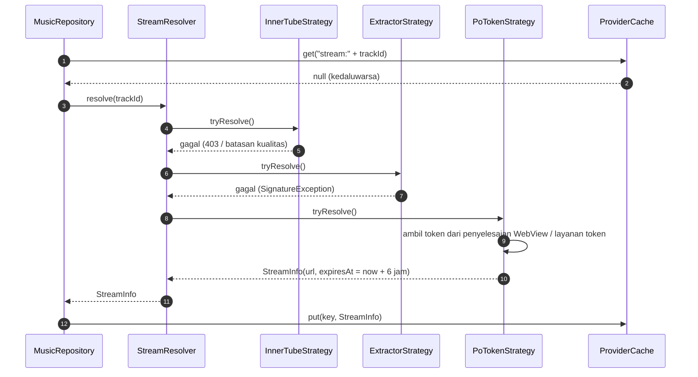

# 04 — Alur Resolver & Penanganan PO Token

Bagian dari PRD Refy v0.1. **Berkas ini berisi risiko terbesar proyek.**

## Konteks

Untuk memutar audio, aplikasi harus mengubah `trackId` menjadi URL audio yang bisa dimakan ExoPlayer. Proses ini ("resolver") bergantung pada perilaku internal YouTube yang tidak dijanjikan stabil. Sejak 2024–2026 YouTube memperketat ini dengan **PO token** (bukti bahwa permintaan berasal dari klien sah).

Gejala saat token tidak valid/absen (terlapor di komunitas, mis. isu NewPipeExtractor Agu 2026): stream tetap terputar **tetapi kualitas turun** (mis. dibatasi 360p) atau ditolak sama sekali. Ini bukan bug yang dapat "diperbaiki sekali", ini perlombaan berkelanjutan.

## Alur resolver

## Hierarki strategi (semua di balik satu antarmuka)

## Aturan yang tidak boleh dilanggar

1. **Semua resolver bersembunyi di balik satu antarmuka.** Tidak ada kode UI atau ViewModel yang tahu strategi mana yang dipakai. Ini yang memungkinkan perbaikan cepat dalam hitungan jam, bukan hari.
2. **URL stream dianggap rahasia sesi.** Tidak di-log, tidak dikirim ke mana pun, tidak ditampilkan di layar debug publik.
3. **Kegagalan resolver ≠ crash.** Selalu berakhir di state yang bisa dilanjutkan pengguna.
4. **Uji kesehatan otomatis.** Satu skrip uji mingguan (dapat dijalankan manual maupun GitHub Actions terjadwal) yang meminta stream untuk 10 trackId tetap dan melaporkan: berhasil ambil URL, bitrate yang diperoleh, waktu respons. Kalau bitrate turun di bawah ambang, buka isu otomatis di repo.
5. **Tidak ada token yang di-hardcode dan di-commit.** Kalau butuh token, ambil saat runtime; simpan hanya di memori.

## Penjagaan "tanpa iklan" di lapisan resolver

Acuan: **EchoMusic 1.4.6** (fork Metrolist), dianalisis lewat REA di `[[Project App/refy-app/REA EchoMusic]]`. Prinsipnya bukan memfilter, melainkan **tidak mampu merepresentasikan iklan**. Empat lapis, semuanya dikerjakan **di sini**, bukan di UI:

**Lapis 1 — model tipe tertutup.** `PlayerResponse` Refy hanya memuat field yang dipakai (EchoMusic: 5 field — `PlayabilityStatus`, `StreamingData`, `VideoDetails`, `PlaybackTracking`, `PlayerConfig`). Serialisasi wajib `ignoreUnknownKeys = true`; **jangan** simpan respons sebagai `JsonElement`/`Map<String,Any>`. Dengan begitu blok `playerAds` yang dikirim server tidak pernah menjadi objek di memori. Model feed juga tidak memuat renderer iklan (`adSlotRenderer`, `promotedSparkles*`, `inFeedAd`).

**Lapis 2 — permintaan tanpa slot iklan.** Body `/youtubei/v1/player` tidak punya field iklan (EchoMusic: 9 field, tanpa `params`/`adParams`). Pakai client music (`WEB_REMIX`/`ANDROID_MUSIC`); hindari `WEB`/`MWEB` sebagai klien utama. Manfaatkan proyeksi server `&$fields=...` supaya server tidak mengirim blok yang tidak diminta. `player/ad_break` tidak pernah dipanggil.

**Lapis 3 — hanya audio.** Ambil `adaptiveFormats`/`formats` ber-`mimeType` `audio/*`; buang kandidat ber-DRM (`drm`, `contentprotection`, `widevine`, `playready`, `fairplay`, `licenseurl`).

**Lapis 4 — uji penjaga.** Uji refleksi DTO (gagal kalau ada field bernama iklan), uji parser dengan fixture yang **sengaja disisipi** `playerAds`, uji intercept body request. Fungsinya regresi: kalau seseorang kelak menambah field iklan, uji merah.

Rincian tugas + kriteria lulus: `backlog.md` §M1.1–M1.6.

**Risiko yang dipantau (belum tertutup):** kalau YouTube menyisipkan iklan audio **server-side ke dalam segmen stream** (bukan track terpisah), keempat lapis ini tidak menolong. Deteksi: uji "lagu berurutan" — putar 10 lagu tanpa menekan next, dengar apakah ada audio asing di antara lagu. Kalau terdeteksi, ini keputusan produk baru (mis. pemotongan segmen), bukan perbaikan bug.

## Rencana kontinjensi bila resolver mati total

| Tahap | Aksi | Waktu |
|---|---|---|
| T+0 | Rilis perbaikan resolver cepat (hotfix), tanpa perubahan UI | ≤ 1 hari |
| T+1 hari | Kalau perbaikan cepat gagal: aktifkan provider alternatif (Audius) di Pengaturan | ≤ 2 hari |
| T+3 hari | Umumkan status di README + issue pinned; jangan diamkan pengguna | ≤ 3 hari |
| Jangka panjang | Pakai kualitas yang dikembalikan apa adanya, jangan janjikan bitrate tertentu di UI | permanen |

## Yang **tidak** akan dilakukan (keputusan sadar)

- Tidak memakai layanan token pihak ketiga yang meminta kredensial akun pengguna.
- Tidak mengirim cookie atau token akun pengguna ke server milik pengembang.
- Tidak menyertakan kunci API rahasia apa pun di dalam APK yang dirilis.
- Tidak mengumpulkan telemetri hasil resolver.
- Tidak memakai library adblock pihak ketiga (`ghostery/adblocker` dsb.) — Refy tidak memuat halaman HTML/JS YouTube, jadi tidak ada request iklan untuk difilter.
- Tidak menyisipkan filter domain/VPN — iklan YouTube datang dari domain yang sama dengan stream; memfilternya akan mematikan pemutaran.
