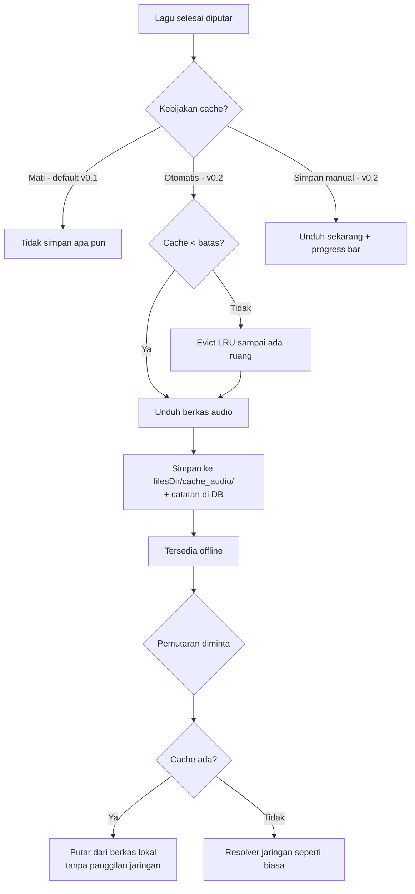
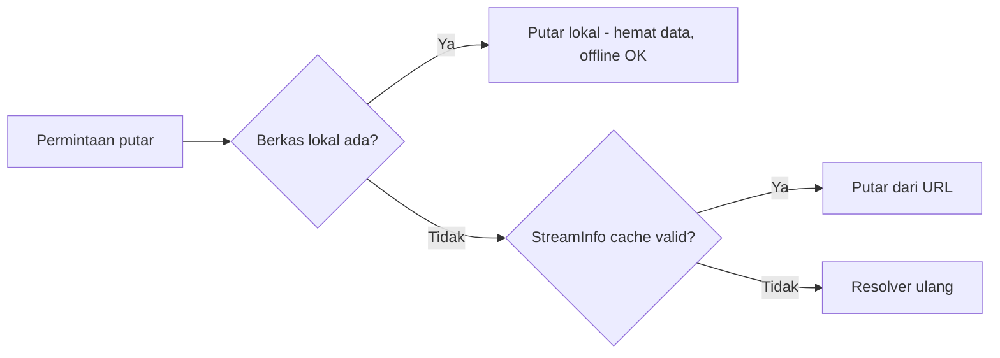

# 05 — Alur Offline Cache (v0.2, Should)

Bagian dari PRD Refy v0.1. Belum masuk MVP; ditulis sekarang supaya skema DB dan batas penyimpanan sudah benar sejak awal.

## Kebijakan cache



## Keputusan yang harus dijaga

| Item | Keputusan |
|---|---|
| Lokasi | `filesDir/cache_audio/` (internal), bukan penyimpanan eksternal |
| Batas default | 2 GB, diatur pengguna (500 MB – 10 GB) |
| Kebijakan eviksi | LRU berdasarkan waktu putar terakhir; tidak pernah menghapus item Favorit |
| Hak cipta | Fitur cache **tidak** dipromosikan sebagai "unduh" dan tidak ada tombol "ekspor"; berkas tidak dapat dibuka aplikasi lain di v1 |
| Ekstensi berkas | Tanpa ekstensi audio yang bisa diputar pemutar lain; metadata disimpan di DB |
| Manual clear | Tersedia di Pengaturan: "Bersihkan cache" + "Bersihkan semua" |
| Hitungan ukuran | Ditampilkan di Pengaturan dengan pembaruan setelah setiap penulisan/penghapusan |"

## Dampak ke skema (siapkan kolom sekarang, walau fitur belum ada)

```sql
ALTER TABLE provider_cache ADD COLUMN local_path TEXT;      -- null = belum ter-cache
ALTER TABLE provider_cache ADD COLUMN size_bytes INTEGER;
ALTER TABLE provider_cache ADD COLUMN last_played_at INTEGER;
```

## Urutan preferensi pemutaran


