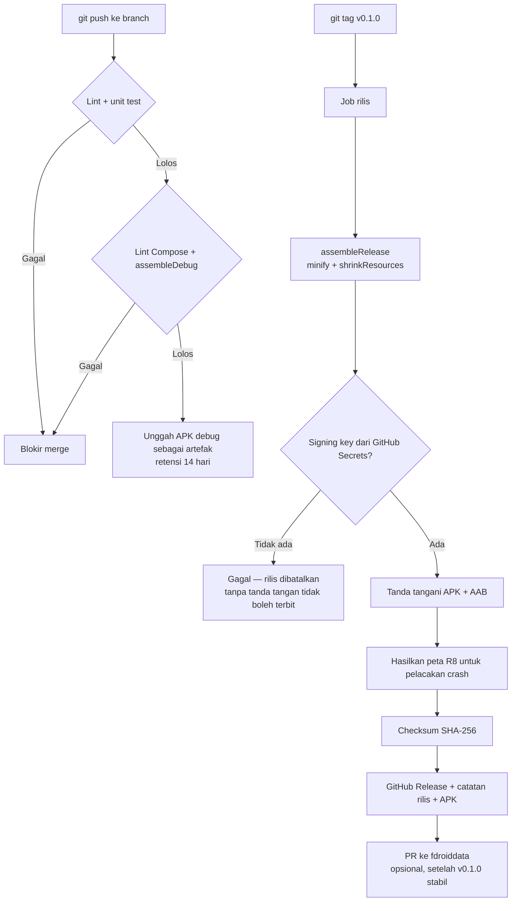
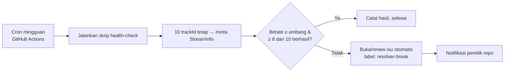

# 06 — Alur Rilis & CI (biaya Rp 0)

Bagian dari PRD Refy v0.1.

## Pipeline



## Aturan rilis

| Aturan | Alasan |
|---|---|
| Rilis **hanya** dari tag `v*` | Menghindari rilis tidak sengaja dari push biasa |
| Signing key **tidak pernah** di repo | Simpan di GitHub Secrets; kunci disimpan offline oleh pemilik |
| Checksum SHA-256 selalu diterbitkan | Pengguna dapat memverifikasi berkas yang diunduh |
| Catatan rilis memuat **perubahan resolver** secara eksplisit | Pengguna tahu kapan harus memperbarui |
| Tidak ada kata "YouTube"/"YT" di `applicationId`, nama APK, atau judul rilis | Melindungi dari keluhan merek |
| Versi legal: `LICENSE` GPL-3.0-or-later + berkas `NOTICE` kredit | NewPipeExtractor GPL-3.0, wajib menyertakan atribusi |
| Rilis gagal lebih baik daripada rilis tanpa tanda tangan | Mencegah varian APK tak sah beredar |"

## Workflow GitHub Actions (kerangka)

```yaml
name: rilis
on:
  push:
    tags: ['v*']
jobs:
  build:
    runs-on: ubuntu-latest
    steps:
      - uses: actions/checkout@v4
      - uses: actions/setup-java@v4
        with: { distribution: temurin, java-version: '21' }
      - uses: gradle/actions/setup-gradle@v4
      - run: ./gradlew lint test assembleRelease
        env:
          SIGNING_KEY_BASE64: ${{ secrets.SIGNING_KEY_BASE64 }}
          SIGNING_KEY_PASSWORD: ${{ secrets.SIGNING_KEY_PASSWORD }}
      - run: sha256sum app/build/outputs/apk/release/*.apk > checksum.txt
      - uses: softprops/action-gh-release@v2
        with:
          files: "|
            app/build/outputs/apk/release/*.apk
            checksum.txt
```

## Workflow dokumen (M0, gerbang sebelum kode ditulis)

Dokumen adalah sumber acuan implementasi, jadi harus dijaga otomatis. Tanpa ini,
nomor layar dan ukuran yang basi kembali masuk seperti yang sudah terjadi dua kali.

```yaml
name: dokumen
on: [push, pull_request]
jobs:
  konsistensi:
    runs-on: ubuntu-latest
    steps:
      - uses: actions/checkout@v4
      - uses: actions/setup-python@v5
        with: { python-version: '3.11' }
      # Gerbang konsistensi butuh repositori git (memeriksa .gitignore lewat
      # `git check-ignore`) dan snapshot Stitch. Snapshot tidak di-commit —
      # tarik ulang dulu, atau jalankan gerbang A–J saja kalau tanpa jaringan.
      - run: python scripts/fetch-electric-purple.py
        env:
          STITCH_API_KEY: ${{ secrets.STITCH_API_KEY }}
      - run: python scripts/check-consistency.py
      - run: python scripts/test-gates.py
```

> Gate K (`git check-ignore`) dan gate I/J butuh berkas di disk. Kalau
> `STITCH_API_KEY` tidak tersedia (mis. repo fork), lewati langkah fetch dan
> catat bahwa gerbang D/I dilewati — jangan menandai hijau tanpa dijalankan.

## Uji kesehatan resolver terjadwal



Skrip ini berbiaya Rp 0 (GitHub Actions gratis untuk repo publik: 2.000 menit/bulan; uji mingguan berjalan < 5 menit per bulan).

## Distribusi

| Jalur | Status | Catatan |
|---|---|---|
| GitHub Releases | Aktif sejak v0.1.0 | Jalur utama; APK + checksum |
| F-Droid | Ditunda | Butuh reproducible build + metadata; ajukan setelah v0.1.0 stabil |
| IzzyOnDroid | Ditunda | Lebih cepat dari F-Droid; bisa jadi langkah antara |
| Play Store | **Tidak** | Akan ditolak (melanggar ToS YouTube) |
